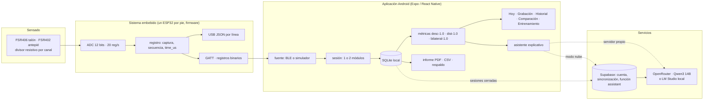

# NSL · Plantillas inteligentes

**NSL** · Plantillas inteligentes — plataforma wearable que adquiere, transmite, procesa, almacena y visualiza señales plantares. Proyecto Final de Ingeniería en Informática (Universidad del Salvador) · Mikel Orgambide Rueda · 2026.

Repositorio: `Mikel-Orgambide/usal-plantillas-inteligentes` · versión entregada: tag `entrega-final` (app 0.15.2, firmware 0.3.1).

Un ESP32 por pie lee sensores de fuerza resistivos (FSR) y envía los registros por Bluetooth a una aplicación Android, que los organiza en sesiones, calcula indicadores descriptivos, guarda el historial, compara sesiones compatibles, genera un informe para revisión profesional, registra el entrenamiento declarado y ofrece un asistente explicativo. El sistema **describe mediciones y su calidad; no diagnostica ni estima fatiga**.

## Inicio rápido (15 minutos)

Tres recorridos independientes; el primero no necesita teléfono ni placa.

**A. Software y pruebas (≈10 min, sólo una PC)**

```bash
git clone https://github.com/Mikel-Orgambide/usal-plantillas-inteligentes.git
cd usal-plantillas-inteligentes
npm install            # Node 24 (.nvmrc) y npm 11
npm run typecheck      # tipos de todos los paquetes y la app
npm test               # 199 pruebas (vitest), deterministas, sin teléfono ni placa
```

**B. App con datos de demostración (≈5 min, teléfono Android)**

1. Instalar la build de demostración: `adb install -r <apk>` (APK de la build `preview`; para generarla: `cd apps/mobile && eas build --profile preview --platform android`).
2. Abrir la app → **Ajustes → Demostración → «Simulador sin plantillas»** (o «Simular dos módulos») → **Nueva sesión** → grabar 30 s → **Detalle**.
3. Cargar sesiones reales: copiar al teléfono `test-data/fisico/sesion-2026-11-03-ca49daed.plantillas.json` y `…-18763da6.plantillas.json` → **Ajustes → Respaldo → Importar sesión** → **Historial → Comparar** → **Exportar informe (PDF)**.

Sin `.env` la app funciona sólo en local (sin cuenta, sincronización ni asistente en modo nube); todo lo demás está disponible.

**C. Hardware (banco)**

Cargar `esp32-analog` (pie izquierdo) y `esp32-analog-right` (pie derecho) desde `firmware/` con PlatformIO; en la app, **Plantillas** → conectar ambos módulos → **Nueva sesión**. Cableado y pines en [Firmware del ESP32](#firmware-del-esp32) y en [`docs/incrementos/etapa-09-fuente-fisica.md`](docs/incrementos/etapa-09-fuente-fisica.md).

## Arquitectura

Cuatro capas (especificación `docs/especificacion/02` y `04`):



- **Contrato de datos** (`packages/contract`): seis posiciones (`L_HEEL`, `L_MEDIAL`, `L_LATERAL`, `R_HEEL`, `R_MEDIAL`, `R_LATERAL`); una configuración declara un subconjunto en ese orden y las posiciones no declaradas son «no disponible», nunca cero. Valores originales en `adc_count`; una lectura fallida es `raw_value = null` + `status = read_error`.
- **Un módulo por pie** (ADR 0011): cada ESP32 lleva tres canales, su captura, secuencia y reloj. Con dos módulos la app alinea por instante de recepción y declara el desfase; las métricas izquierda/derecha se calculan sólo en tramos con ambos.
- **Offline-first**: SQLite es la fuente primaria; Supabase sincroniza sesiones cerradas (ADR 0008).
- **Asistente** (ADR 0012): contexto armado en el teléfono, rechazo fijo de consultas clínicas; la clave del proveedor vive sólo como secreto de la función.

## Estructura del monorepo

| Carpeta | Contenido |
|---|---|
| `apps/mobile` | Aplicación Android (Expo SDK 57, React Native, TypeScript, Expo Router) |
| `packages/contract` | Contrato de datos: versión, configuración de canales y validación en ejecución |
| `packages/simulator` | Fuente simulada determinista con escenarios de falla y deriva de reloj |
| `packages/storage` | Esquema SQLite versionado, repositorio, cola de escritura, respaldo |
| `packages/session` | Coordinador de sesiones (máquina de estados, uno o dos módulos, recuperación) |
| `packages/metrics` | Métricas descriptivas por canal, distribución y bilaterales, con versión de algoritmo |
| `packages/ble` | Protocolo BLE de la plantilla y fuente de datos física |
| `packages/sync` | Sincronización de sesiones con el servicio remoto |
| `packages/report` | Informe de sesión (HTML → PDF) y exportación CSV, funciones puras |
| `packages/assistant` | Cliente del asistente (directo o por la función), armado de contexto, filtro de alcance, prompt |
| `packages/training` | Rutinas, entrenamientos, series, actividad (cursor, descanso, caminata) y resumen declarado |
| `supabase` | Esquema remoto (migraciones 0001–0005, RLS), función `assistant` y prueba en PostgreSQL local |
| `firmware` | Firmware del ESP32 (PlatformIO, Arduino Core) |
| `scripts` | Utilidades: validador de logs serie, capturas de pantalla por `adb`, comprobación remota |
| `test-data` | Datos de prueba identificados por origen: `simulator/`, `firmware/`, `fisico/`, `remote/`, `backup/` |
| `docs/tesis` | Material base para redactar la tesis (especificación final, evidencia, mapa, defensa, uso de IA) |
| `docs/especificacion` | Bases de desarrollo (00 → 08) |
| `docs/decisiones` | Registro de decisiones de arquitectura (ADR) |
| `docs/incrementos` | Evidencia de cada etapa |
| `docs/diseno` | Brief de interfaz, marca, Figma |

## Configuración

Ningún secreto va al repositorio: `.env` y `.env.*` están en `.gitignore`; sólo se versionan los `.env.example` con los nombres de las variables.

**App** — copiar `apps/mobile/.env.example` como `apps/mobile/.env`:

| Variable | Para qué | Obligatoria |
|---|---|---|
| `EXPO_PUBLIC_SUPABASE_URL` | URL del proyecto Supabase | No (sin ella: sólo local) |
| `EXPO_PUBLIC_SUPABASE_PUBLISHABLE_KEY` | Clave pública (publishable) de Supabase. La secret key **nunca** va en la app | No (sin ella: sólo local) |
| `REMOTE_CHECK_EMAIL_A` / `REMOTE_CHECK_PASSWORD_A` | Cuenta de prueba A para `scripts/remote-check.mjs` | Sólo para esa prueba |
| `REMOTE_CHECK_EMAIL_B` / `REMOTE_CHECK_PASSWORD_B` | Cuenta de prueba B (verifica aislamiento por RLS) | Sólo para esa prueba |

**Base remota** — en el SQL Editor de Supabase ejecutar en orden `supabase/migrations/0001…0005` (0005, entrenamiento, es opcional: la transferencia no está implementada).

**Función `assistant` (modo nube del asistente)** — secretos de Supabase; nombres en `supabase/functions/.env.example`:

| Secreto | Para qué | Por defecto |
|---|---|---|
| `ASSISTANT_API_KEY` | Clave del proveedor compatible con OpenAI (OpenRouter) | — (obligatoria) |
| `ASSISTANT_BASE_URL` | URL base de la API | `https://openrouter.ai/api/v1` |
| `ASSISTANT_MODEL` | Modelo | `qwen/qwen3-14b` |
| `ASSISTANT_HOURLY_LIMIT` | Consultas por hora por usuario | `30` |
| `ASSISTANT_REFERER` / `ASSISTANT_TITLE` | Encabezados opcionales de atribución | vacío / `NSL · Plantillas inteligentes` |

`SUPABASE_URL`, `SUPABASE_ANON_KEY` y `SUPABASE_SERVICE_ROLE_KEY` los inyecta Supabase. Carga y despliegue:

```bash
supabase link --project-ref <ref-del-proyecto>
supabase secrets set ASSISTANT_API_KEY=<clave> ASSISTANT_MODEL=qwen/qwen3-14b
supabase functions deploy assistant
```

**Modo servidor propio** — sin secretos: LM Studio en una PC de la misma red con el servidor en `0.0.0.0:1234` y un modelo Qwen3 cargado; en la app, **Ajustes → Asistente → Servidor propio** con `http://<ip-de-la-pc>:1234`.

## Cómo correr

### Requisitos

- Node 24 (`.nvmrc`) y npm 11.
- Para la app en el teléfono: cuenta de Expo (`npm i -g eas-cli`, `eas login`) y Android SDK con `adb`.
- Para el firmware: VS Code + PlatformIO IDE y el driver USB del conversor de la placa (CP210x).
- Para la función del asistente: CLI de Supabase.

### Monorepo

```bash
git clone https://github.com/Mikel-Orgambide/usal-plantillas-inteligentes.git
cd usal-plantillas-inteligentes
npm install
npm run typecheck      # tipos de todos los paquetes y la app
npm test               # vitest, sin teléfono ni placa
```

### App en el teléfono

La app usa módulos nativos (SQLite, Bluetooth, archivos, impresión), así que no corre en Expo Go: se instala una build propia y después se desarrolla con el servidor de Metro.

```bash
cd apps/mobile
cp .env.example .env                                   # URL y publishable key de Supabase (opcional: sin ellas funciona sólo en local)
eas build --profile development --platform android     # una vez, y cada vez que cambian módulos nativos
adb install -r <apk descargado>                        # instalación por cable
npx expo start                                         # servidor de desarrollo
```

Build autónoma para demostración: `eas build --profile preview --platform android`. Los comandos de `eas` se ejecutan dentro de `apps/mobile`.

### Firmware del ESP32

Abrir `firmware/` en VS Code con PlatformIO, conectar la placa por USB y cargar el entorno que corresponda (mantener **BOOT/IO0** apretado mientras dice `Connecting…`):

| Entorno | Qué hace | Configuración |
|---|---|---|
| `esp32-synthetic` | Lecturas sintéticas generadas en la placa, sin sensores (pruebas de transporte) | `ESP32-SYN-001` (6 canales) |
| `esp32-analog` | Módulo del pie izquierdo: tres divisores FSR en GPIO 36/39/34 | `ESP32-FSR-L-001` |
| `esp32-analog-right` | Módulo del pie derecho, mismos pines | `ESP32-FSR-R-001` |
| `esp32-adc-test` | Imprime las cuentas crudas de los seis pines por USB, sin BLE ni contrato (banco) | — |

```powershell
pio run -e esp32-analog -t upload -t monitor      # carga y abre el monitor a 230400
python scripts\check_serial.py firmware\logs\<log>.log   # valida secuencia, período y errores de una corrida USB
```

Detalles en [`firmware/README.md`](firmware/README.md) y en [`docs/guia-arranque-y-pruebas.md`](docs/guia-arranque-y-pruebas.md).

## Estado del prototipo

Distinguimos siempre lo **validado con hardware real**, lo **implementado y comprobado con datos simulados** y lo que es **diseño**. Fuente: [`docs/especificacion/08_Alcance_Final_del_Prototipo.md`](docs/especificacion/08_Alcance_Final_del_Prototipo.md) y [`docs/incrementos`](docs/incrementos/README.md).

| Validado con hardware real | Implementado, comprobado con simulación o pruebas automáticas | Diseño / evolución futura |
|---|---|---|
| Módulo unilateral de tres FSR (2,2 kΩ talón, 4,7 kΩ antepié) leído por el ESP32: reposo 0, respuesta monótona, sin saturación con el pie (3/11) | Sesión bilateral con dos módulos BLE, estado por módulo, pérdida y reconexión de uno, métricas `bilateral-1.0` (etapa 13; validación con dos placas prevista el 6/11) | Plantilla física integrada en calzado, cableado al cuerpo, alimentación autónoma, marcha |
| USB: 475 registros sin saltos a 50,00 ms, 0 lecturas fallidas | Rutinas y entrenamiento declarado, actividad con descansos, carga asistida de series (etapa 15) | Calibración a newtons o presión |
| BLE → app: dos sesiones físicas (436 y 609 registros, sin saltos), apoyo estático con el pie, pie derecho «n/d» | CSV por muestra | Sincronización de rutinas y entrenamientos (esquema 0005 preparado) |
| Informe PDF sobre las sesiones físicas (etapa 12) | Respaldo, restauración y sincronización con Supabase y RLS 10/10 (etapas 10 y 11, verificadas en el teléfono con sesiones simuladas y sintéticas) | Pruebas de uso con personas |
| Asistente explicativo en modo nube y servidor propio con sesiones físicas (etapa 14, 4/11) | | |

Todas las pruebas con hardware se hicieron **en banco, sobre protoboard**, con la electrónica fuera del calzado y alimentación por USB; no hubo pruebas de uso con personas.

## Limitaciones declaradas

- Las cuentas ADC no son newtons ni presión: no hay calibración de fuerza. La misma lectura en dos sensores de distinto modelo o ubicación no implica la misma carga.
- Los FSR presentan deriva bajo carga constante (creep) y una repetibilidad del orden del 10 % entre colocaciones; tres posiciones por pie no son un mapa de presión.
- El tiempo de adquisición (`time_us`, 32 bits, por módulo) y el de recepción son referencias distintas; entre dos módulos sólo se estima un desfase.
- El entrenamiento es declarado por la persona: la app no verifica repeticiones, pesos ni tiempos.
- El asistente explica indicadores ya calculados; no diagnostica. En modo nube el contexto pasa por un proveedor externo.
- Sin emparejamiento BLE; `configuration_id` sin `device_id`; sin recuperación de contraseña en la app; sin descarga inversa desde el servidor; el proyecto Supabase del plan Free se pausa tras 7 días sin actividad.

## Documentación para la tesis

[`docs/tesis/`](docs/tesis/) reúne, en puntos y tablas, el material para redactar el documento final: índice y convención de estados ([`00_LEEME.md`](docs/tesis/00_LEEME.md)), especificación final con requisitos y evidencia, arquitectura y código, funcionalidades por pantalla, evidencia y protocolos de prueba, mapa capítulo por capítulo, guion de defensa, glosario y declaración de uso de IA.

## Evidencia y decisiones

- Evidencia por etapa: [`docs/incrementos`](docs/incrementos/) — p. ej. [etapa 9, fuente física](docs/incrementos/etapa-09-fuente-fisica.md) y [etapa 13, bilateral](docs/incrementos/etapa-13-bilateral.md). Datos: [`test-data`](test-data/) (`fisico/` contiene los exports de las sesiones reales y los logs serie).
- Decisiones de arquitectura: [`docs/decisiones`](docs/decisiones/) — ADR 0001 stack, 0002 monorepo y flujo, 0003 nube y distribución, 0004 persistencia local, 0005 interfaz, 0006 transporte USB y BLE, 0007 respaldo, 0008 complemento remoto, 0009 marca .NSL, 0010 informe para revisión profesional, 0011 dos módulos, 0012 asistente explicativo, 0013 rutinas y entrenamiento.
- Cambios por versión: [`CHANGELOG.md`](CHANGELOG.md).

## Flujo de trabajo

- `main` siempre compila y pasa CI (GitHub Actions: typecheck + pruebas).
- Commits con [Conventional Commits](https://www.conventionalcommits.org/es/v1.0.0/). Cada etapa cerrada genera un tag `vX.Y-etapaN` y una entrada en `docs/incrementos`; las decisiones técnicas nuevas, una ADR. La versión entregada lleva el tag `entrega-final`.
- Reglas para asistentes de IA que trabajen en el repo: [`CLAUDE.md`](CLAUDE.md).

## Licencia y autoría

Código y documentación bajo licencia [MIT](LICENSE) © 2026 Mikel Orgambide Rueda. La marca «.NSL» es parte del prototipo y de la tesis, no un registro comercial (ADR 0009). El desarrollo contó con asistencia de herramientas de IA (Claude, Claude Code, Codex, ChatGPT, Claude Design) para investigación, código, pruebas, diseño y redacción técnica, con revisión y decisiones del autor; el registro de ese uso está en [`docs/tesis/08_Uso_de_IA.md`](docs/tesis/08_Uso_de_IA.md), `docs/especificacion/06_Sintesis_Continuidad_y_Uso_IA.md` y las entradas de `docs/incrementos`.
