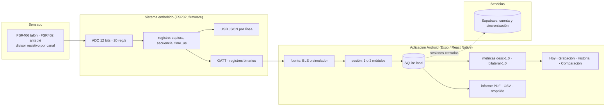

# NSL · Plantillas inteligentes

**NSL** · Plantillas inteligentes — plataforma wearable que adquiere, transmite, procesa, almacena y visualiza señales plantares. Proyecto Final de Ingeniería en Informática (Universidad del Salvador) · Mikel Orgambide Rueda · 2026.

Un ESP32 lee sensores de fuerza resistivos (FSR) colocados bajo el pie y envía los registros por Bluetooth a una aplicación Android, que los organiza en sesiones, calcula indicadores descriptivos, guarda el historial, compara sesiones compatibles y genera un informe para revisión profesional. El sistema **describe mediciones y su calidad; no diagnostica ni estima fatiga**.

## Arquitectura

Cuatro capas (especificación `docs/especificacion/02` y `04`):



- **Contrato de datos** (`packages/contract`): seis posiciones (`L_HEEL`, `L_MEDIAL`, `L_LATERAL`, `R_HEEL`, `R_MEDIAL`, `R_LATERAL`); una configuración declara un subconjunto en ese orden y las posiciones no declaradas son «no disponible», nunca cero. Valores originales en `adc_count`; una lectura fallida es `raw_value = null` + `status = read_error`.
- **Un módulo por pie** (ADR 0011): cada ESP32 lleva tres canales, su captura, secuencia y reloj. Con dos módulos la app alinea por instante de recepción y declara el desfase; las métricas izquierda/derecha se calculan sólo en tramos con ambos.
- **Offline-first**: SQLite es la fuente primaria; Supabase sincroniza sesiones cerradas (ADR 0008).

## Estructura del monorepo

| Carpeta | Contenido |
|---|---|
| `apps/mobile` | Aplicación Android (Expo SDK 57, React Native, TypeScript, Expo Router) |
| `packages/contract` | Contrato de datos: versión, configuración de canales y validación en ejecución |
| `packages/simulator` | Fuente simulada determinista con escenarios de falla y deriva de reloj |
| `packages/storage` | Esquema SQLite versionado, repositorio, cola de escritura, respaldo |
| `packages/session` | Coordinador de sesiones (máquina de estados, uno o dos módulos, recuperación) |
| `packages/metrics` | Métricas descriptivas por canal y bilaterales, con versión de algoritmo |
| `packages/ble` | Protocolo BLE de la plantilla y fuente de datos física |
| `packages/sync` | Sincronización de sesiones con el servicio remoto |
| `packages/report` | Informe de sesión (HTML → PDF) y exportación CSV, funciones puras |
| `supabase` | Esquema remoto (RLS, funciones de sincronización) y su prueba en PostgreSQL local |
| `firmware` | Firmware del ESP32 (PlatformIO, Arduino Core) |
| `scripts` | Utilidades: validador de logs serie, capturas de pantalla por `adb`, comprobación remota |
| `test-data` | Datos de prueba identificados por origen: `simulator/`, `firmware/`, `fisico/`, `remote/`, `backup/` |
| `docs/especificacion` | Bases de desarrollo (00 → 07) |
| `docs/decisiones` | Registro de decisiones de arquitectura (ADR) |
| `docs/incrementos` | Evidencia de cada etapa |
| `docs/diseno` | Brief de interfaz, marca, Figma |

## Cómo correr

### Requisitos

- Node 24 (`.nvmrc`) y npm 11.
- Para la app en el teléfono: cuenta de Expo (`npm i -g eas-cli`, `eas login`) y Android SDK con `adb`.
- Para el firmware: VS Code + PlatformIO IDE y el driver USB del conversor de la placa (CP210x).

### Monorepo

```bash
git clone https://github.com/Mikel-Orgambide/proyecto-final-plantillas-inteligentes.git
cd proyecto-final-plantillas-inteligentes
npm install
npm run typecheck      # tipos de todos los paquetes y la app
npm test               # vitest, sin teléfono ni placa
```

### App en el teléfono

La app usa módulos nativos (SQLite, Bluetooth, archivos, impresión), así que no corre en Expo Go: se instala una build propia y después se desarrolla con el servidor de Metro.

```bash
cd apps/mobile
cp .env.example .env                                   # URL y publishable key de Supabase (opcional: sin ellas funciona sólo en local)
eas build --profile development --platform android     # una vez, y cada vez que cambian módulos nativos
adb install -r <apk descargado>                        # instalación por cable
npx expo start                                         # servidor de desarrollo
```

Build autónoma para demostración: `eas build --profile preview --platform android`. Los comandos de `eas` se ejecutan dentro de `apps/mobile`.

### Firmware del ESP32

Abrir `firmware/` en VS Code con PlatformIO, conectar la placa por USB y cargar el entorno que corresponda (mantener **BOOT/IO0** apretado mientras dice `Connecting…`):

| Entorno | Qué hace | Configuración |
|---|---|---|
| `esp32-synthetic` | Lecturas sintéticas generadas en la placa, sin sensores (pruebas de transporte) | `ESP32-SYN-001` (6 canales) |
| `esp32-analog` | Módulo del pie izquierdo: tres divisores FSR en GPIO 36/39/34 | `ESP32-FSR-L-001` |
| `esp32-analog-right` | Módulo del pie derecho, mismos pines | `ESP32-FSR-R-001` |
| `esp32-adc-test` | Imprime las cuentas crudas de los seis pines por USB, sin BLE ni contrato (banco) | — |

```powershell
pio run -e esp32-analog -t upload -t monitor      # carga y abre el monitor a 230400
python scripts\check_serial.py firmware\logs\<log>.log   # valida secuencia, período y errores de una corrida USB
```

Detalles en [`firmware/README.md`](firmware/README.md) y en [`docs/guia-arranque-y-pruebas.md`](docs/guia-arranque-y-pruebas.md).

## Estado del prototipo

Distinguimos siempre lo **validado con hardware real**, lo **implementado y comprobado con datos simulados** y lo que es **diseño**. Fuente: [`docs/incrementos`](docs/incrementos/README.md).

| Validado con hardware real (3/11/2026) | Implementado, comprobado con simulación | Diseño / evolución futura |
|---|---|---|
| Módulo unilateral de tres FSR (2,2 kΩ talón, 4,7 kΩ antepié) leído por el ESP32: reposo 0, respuesta monótona, sin saturación con el pie | Sesión bilateral con dos módulos BLE, estado por módulo, pérdida y reconexión de uno, métricas `bilateral-1.0` (etapa 13; validación con dos placas prevista) | Plantilla física integrada en calzado, cableado al cuerpo, alimentación autónoma, marcha |
| USB: 475 registros sin saltos a 50,00 ms, 0 lecturas fallidas | Informe PDF y CSV (etapa 12) sobre paquetes físicos y simulados | Calibración a newtons o presión |
| BLE → app: dos sesiones físicas (436 y 609 registros, sin saltos), apoyo estático con el pie, pie derecho «n/d» | Respaldo, restauración y sincronización remota (etapas 10 y 11, verificadas en dispositivo con datos simulados y sintéticos) | Asistente explicativo (etapa 14) |

Todas las pruebas con hardware se hicieron **en banco, sobre protoboard**, con la electrónica fuera del calzado y alimentación por USB; no hubo pruebas de uso con personas.

## Limitaciones declaradas

- Las cuentas ADC no son newtons ni presión: no hay calibración de fuerza. La misma lectura en dos sensores de distinto modelo o ubicación no implica la misma carga.
- Los FSR presentan deriva bajo carga constante (creep) y una repetibilidad del orden del 10 % entre colocaciones; tres posiciones por pie no son un mapa de presión.
- El tiempo de adquisición (`time_us`, 32 bits, por módulo) y el de recepción son referencias distintas; entre dos módulos sólo se estima un desfase.
- Sin emparejamiento BLE; `configuration_id` sin `device_id`; sin recuperación de contraseña en la app; sin descarga inversa desde el servidor; el proyecto Supabase del plan Free se pausa tras 7 días sin actividad.

## Evidencia y decisiones

- Evidencia por etapa: [`docs/incrementos`](docs/incrementos/) — p. ej. [etapa 9, fuente física](docs/incrementos/etapa-09-fuente-fisica.md) y [etapa 13, bilateral](docs/incrementos/etapa-13-bilateral.md). Datos: [`test-data`](test-data/) (`fisico/` contiene los exports de las sesiones reales y los logs serie).
- Decisiones de arquitectura: [`docs/decisiones`](docs/decisiones/) — ADR 0001 stack, 0002 monorepo y flujo, 0003 nube y distribución, 0004 persistencia local, 0005 interfaz, 0006 transporte USB y BLE, 0007 respaldo, 0008 complemento remoto, 0009 marca .NSL, 0010 informe para revisión profesional, 0011 dos módulos.
- Cambios por versión: [`CHANGELOG.md`](CHANGELOG.md).

## Flujo de trabajo

- `main` siempre compila y pasa CI (GitHub Actions: typecheck + pruebas).
- Commits con [Conventional Commits](https://www.conventionalcommits.org/es/v1.0.0/). Cada etapa cerrada genera un tag `vX.Y-etapaN` y una entrada en `docs/incrementos`; las decisiones técnicas nuevas, una ADR.
- Reglas para asistentes de IA que trabajen en el repo: [`CLAUDE.md`](CLAUDE.md).

## Licencia y autoría

Código y documentación bajo licencia [MIT](LICENSE) © 2026 Mikel Orgambide Rueda. La marca «.NSL» es parte del prototipo y de la tesis, no un registro comercial (ADR 0009). El desarrollo contó con asistencia de herramientas de IA (Claude, Codex) para investigación, código, pruebas y redacción técnica, con revisión y decisiones del autor; el registro de ese uso está en `docs/especificacion/06_Sintesis_Continuidad_y_Uso_IA.md` y en las entradas de `docs/incrementos`.
