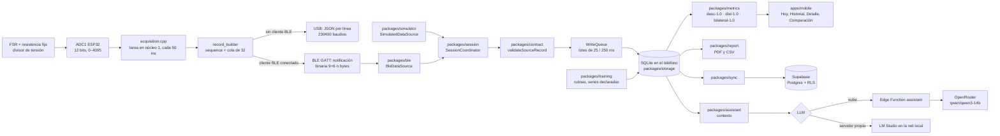

# 02 · Arquitectura y código del prototipo

Material de base para la tesis (capítulos 4, 7 y anexos). No es texto para copiar: son los hechos verificados contra el código del repositorio al 5/11/2026 (commit `01487bf`, app **0.15.2**, firmware **0.3.1**); actualizado el 11/11/2026 al commit `cb3b25b` (app **0.15.3**) tras la validación con dos placas. Cada afirmación cita la ruta del archivo. Lo que no se pudo confirmar en el código está marcado **«a verificar»**.

Estados usados en las tablas: **[H]** validado con hardware real · **[S]** validado sólo con simulación o pruebas automáticas · **[D]** diseñado o preparado, sin ejecutar.

---

## 1. Vista general

### 1.1 Cuatro capas

| Capa | Qué hace | Dónde vive en el repo |
|---|---|---|
| **Sensado** | 3 FSR por pie (talón FSR406; antepié medial y lateral FSR402) en divisores de tensión con resistencia fija (2,2 kΩ talón, 4,7 kΩ antepié), montados en protoboard | Hardware; parámetros en `firmware/include/configuration.h` |
| **Sistema embebido** | ESP32 (Arduino Core) lee 3 entradas ADC1 de 12 bits cada 50 ms, arma registros con secuencia y tiempo por muestra, los encola y los envía por USB (JSON por línea) o BLE (GATT, binario) | `firmware/` |
| **Servicios** | En el teléfono: validación del contrato, coordinación de sesión, persistencia SQLite, métricas, informe, CSV, entrenamiento. En la nube (opcional): Supabase (cuentas, copia de sesiones, función del asistente) y un proveedor de LLM | `packages/*`, `supabase/` |
| **Aplicación** | App Android (Expo/React Native): conexión, grabación en vivo, historial, detalle, comparación, exportación, asistente, rutinas | `apps/mobile/` |

Decisión de arquitectura: **local-first**. Todo funciona sin red: la base vive en el teléfono (ADR 0004) y la nube es un complemento que copia sesiones cerradas (ADR 0008). La plataforma admite **uno o dos módulos** (un ESP32 por pie, ADR 0011).

### 1.2 Flujo de datos de punta a punta



Separación clave que atraviesa todo el código: **origen de la señal** (`physical` | `simulated`, lo fija el adaptador que recibió el dato) es independiente del **transporte** (USB o BLE). Una placa real que manda números sintéticos (`esp32-synthetic`) es señal simulada aunque viaje por BLE (`packages/contract/src/channels.ts`, `DataSourceKind`).

---

## 2. Monorepo y herramientas

### 2.1 Estructura

```
apps/mobile/          App Expo (expo-router), capas presentation / application / infrastructure
packages/contract     Contrato de datos v1.0 (tipos, validación, secuencia)
packages/simulator    Simulador determinista de la fuente
packages/ble          Protocolo GATT y fuente de datos física
packages/session      Coordinador de sesión (máquina de estados, uno o dos módulos)
packages/metrics      Métricas descriptivas, distribución, comparación, bilateral
packages/storage      SQLite: esquema, migraciones, repositorios, cola de escritura, respaldo
packages/sync         Sincronización con Supabase
packages/report       Informe HTML→PDF y CSV
packages/assistant    Asistente: alcance, contexto, prompt, cliente
packages/training     Rutinas, entrenamiento, actividad, carga asistida
firmware/             PlatformIO (ESP32, Arduino Core, C++17)
supabase/             Migraciones SQL, Edge Function, pruebas SQL
scripts/              Utilidades (validación serie, capturas, verificación remota, prompt compartido)
docs/                 Especificación, ADR 0001–0013, evidencia por etapa, diseño, capturas
test-data/            Datos de prueba y evidencia (sesiones físicas exportadas, logs)
```

Workspaces npm declarados en `package.json` raíz: `apps/*`, `packages/*`. Scripts raíz: `typecheck` y `test` recorren todos los workspaces; `mobile`, `android`. Motor: Node ≥ 22 (`.nvmrc`, el autor usa Node 24). Los paquetes exportan TypeScript fuente (`main: src/index.ts`), sin paso de compilación propio: los consume Metro (app) y Vitest (pruebas).

### 2.2 Versiones reales

| Elemento | Versión | Fuente |
|---|---|---|
| App (nombre visible «NSL») | 0.15.3 | `apps/mobile/app.json` (`expo.version`) |
| Firmware en el repositorio | 0.3.1 | `firmware/` |
| Firmware cargado en las placas de la evidencia | Izquierda `ESP32-9E7EE4` (`ESP32-FSR-L-001`): **0.3.0** · derecha `ESP32-68D1D8` (`ESP32-FSR-R-001`): **0.3.1** | `04_Evidencia_y_pruebas.md` §3 bis. 0.3.1 sólo agrega el entorno `esp32-analog-right`; la placa izquierda no se recargó |
| Expo SDK | ~57.0.31 | `apps/mobile/package.json` |
| React Native / React | 0.86.3 / 19.2.3 | ídem |
| expo-router | ~57.0.29 | ídem |
| expo-sqlite (base local y kv-store) | ~57.0.4 | ídem |
| expo-print / expo-sharing | ~57.0.2 / ~57.0.24 | ídem |
| BLE nativo | react-native-ble-manager 12.5.3 | ídem |
| Supabase JS | ^2.118.0 | ídem |
| react-native-svg | 15.15.4 | ídem |
| Tipografía | @expo-google-fonts/manrope ^0.4.2 | ídem |
| TypeScript | ~6.0.3 | paquetes |
| Vitest | ^5.0.5 | paquetes |
| Firmware | 0.3.1 | `firmware/include/configuration.h` (`FIRMWARE_VERSION`) |
| Plataforma PlatformIO | espressif32, placa `esp32dev`, framework arduino | `firmware/platformio.ini` |
| Librerías firmware | NimBLE-Arduino ^2.3.0 (instalada 2.5.2), ArduinoJson ^7.4.0 (7.4.3) | ídem y log de compilación |
| Contrato de datos | 1.0 (`FORMAT_VERSION`) | `packages/contract/src/types.ts` |
| Esquema SQLite local | versión 8 | `packages/storage/src/schema.ts` |
| Esquema remoto | migraciones 0001–0005 | `supabase/migrations/` |

Identificadores de la app: paquete Android `com.mikelorgambide.plantillasinteligentes`, `slug` `plantillas-inteligentes`, `scheme` `plantillas`, proyecto EAS `3b47649d-…` (`app.json`). Builds con EAS (perfiles development / preview / production; APK).

Plugins de configuración nativa en `app.json`: `expo-router`, `expo-font`, `react-native-ble-manager` (`neverForLocation: true`), `expo-splash-screen` (fondo `#0c0d10`), `expo-sharing`, `expo-build-properties` (`android.usesCleartextTraffic: true`, para el modo «Servidor propio» del asistente por `http://` en la red local). Teclado: `softwareKeyboardLayoutMode: resize`.

### 2.3 Calidad automatizada

- **Pruebas**: Vitest por paquete. Cantidad de casos (`it`/`test`) contados en `packages/*/test`: contract 25, simulator 16, ble 20, session 19, metrics 29, storage 29, sync 9, report 9, assistant 28, training 15 → **199**. La app (`apps/mobile`) no tiene pruebas unitarias propias; se verifica con `tsc --noEmit` y pruebas manuales documentadas en `docs/incrementos/`.
- **Tipos**: `npm run typecheck` (`tsc --noEmit` en cada workspace).
- **CI**: `.github/workflows/ci.yml` — en cada push a `main` y en pull requests: `npm ci`, `npm run typecheck`, `npm test` sobre Ubuntu con la versión de Node de `.nvmrc`.
- **Firmware**: sin pruebas automáticas; se valida con logs del monitor serie y `scripts/check_serial.py`.
- **Esquema remoto**: pruebas SQL en PostgreSQL 16 local con `supabase/tests/auth-shim.sql` (imita `auth.uid()` y roles), `check-rls.sql`, `check-bilateral.sql`.

---

## 3. Firmware (`firmware/`)

Proyecto PlatformIO en C++17 sobre Arduino Core para ESP32. Decisión de transporte: ADR 0006.

### 3.1 Entornos PlatformIO (`firmware/platformio.ini`)

| Entorno | Bandera | Qué compila | Uso |
|---|---|---|---|
| `esp32-synthetic` (por defecto) | `-DACQ_SYNTHETIC=1` | Firmware completo con señal **sintética** de 6 canales generada en la placa | Probar transporte USB/BLE y la app sin sensores (H1, H5, H6) |
| `esp32-analog` | `-DACQ_ANALOG=1` | Firmware completo, **3 FSR del pie izquierdo** (`ESP32-FSR-L-001`) | Módulo izquierdo real |
| `esp32-analog-right` | `-DACQ_ANALOG=1 -DACQ_FOOT_RIGHT=1` | Igual, **pie derecho** (`ESP32-FSR-R-001`, códigos `R_*`) | Segundo módulo (ADR 0011); cargado el 11/11 en la placa `ESP32-68D1D8`, con banco propio en una segunda protoboard |
| `esp32-adc-test` | `build_src_filter = +<adc_test/>` | Programa mínimo `src/adc_test/adc_test.cpp`: imprime 6 cuentas crudas cada 100 ms | Banco del ADC (H2–H4), sin BLE ni contrato |

Parámetros comunes: `monitor_speed = 230400`, `upload_speed = 115200` (a 460800 la carga se cortó al 54 %), `monitor_filters = default, log2file` (guarda logs en `firmware/logs/`).

### 3.2 Constantes reales (`firmware/include/configuration.h`)

| Constante | Valor | Significado |
|---|---|---|
| `FORMAT_VERSION` | `"1.0"` | Versión del contrato |
| `FIRMWARE_VERSION` | `"0.3.1"` | Versión del firmware |
| `RAW_MAX` | 4095 | ADC de 12 bits |
| `READ_ERROR_VALUE` | `0xFFFF` | Valor binario que representa una lectura fallida |
| `SAMPLE_PERIOD_US` | 50 000 | **20 registros/s** («punto de partida, no tasa validada») |
| `QUEUE_CAPACITY` | 32 | Registros en la cola entre adquisición y transmisión |
| `CHANNEL_COUNT` | 3 (analógico) / 6 (sintético) | |
| `CHANNEL_CODES` | `L_HEEL, L_MEDIAL, L_LATERAL` (o `R_*`) | Orden del contrato |
| `CHANNEL_PINS` | `{36, 39, 34}` | GPIO de ADC1 (en la placa: SVP, SVN, P34). ADC2 no funciona con radio activa |
| `CHANNEL_MODELS` | `FSR406, FSR402, FSR402` | Denominación comercial; no acredita fabricante |
| `CHANNEL_FIXED_RESISTOR_OHM` | `{2200, 4700, 4700}` | Resistencia fija del divisor, elegida en banco el 3/11 (H2). Informativa: no viaja en el contrato |
| `CONFIGURATION_ID` | `ESP32-FSR-L-001` / `ESP32-FSR-R-001` / `ESP32-SYN-001` | |

### 3.3 Módulos

| Módulo | Archivo(s) | Responsabilidad |
|---|---|---|
| configuration | `include/configuration.h` | Constantes anteriores según el entorno |
| acquisition | `include/acquisition.h`, `src/acquisition.cpp` | `acq::begin()` fija resolución 12 bits y pines como entrada; `acq::read_all(t0, out[])` lee los canales **en orden**, cada muestra con su `time_us` tomado **al comenzar la lectura** relativo al inicio de la captura. Un valor fuera de 0..4095 se marca `READ_ERROR_VALUE`, nunca se convierte en 0. En el entorno sintético genera una alternancia izquierda/derecha (período 1,2 s) y fuerza un `read_error` cada 97 registros en `R_LATERAL` para ejercitar ese camino |
| clock | `include/clock.h` | `clk::now_us()` = `esp_timer_get_time()`: reloj monotónico en µs desde el arranque. No es hora civil |
| capture_controller | `include/capture_controller.h`, `src/capture_controller.cpp` | `device_id` = `ESP32-` + 3 últimos bytes de la MAC (p. ej. `ESP32-9E7EE4`). Contador de **arranques** persistido en **NVS** (`Preferences`, espacio `plantillas`, clave `boot`) que se incrementa en cada encendido. `start()` crea una captura nueva: número de captura +1, `sequence = 0`, origen temporal nuevo y contadores a cero. `capture_id = <device_id>-B<arranque>-C<n>`: no se repite entre reinicios ni dentro de un arranque |
| record_builder | `include/record_builder.h`, `src/record_builder.cpp` | `acquire_one()`: si hay captura activa, consume un número de secuencia, lee los canales y encola. **Si la cola está llena, el registro se descarta después de consumir su secuencia**, de modo que el hueco es observable del otro lado. Cola circular protegida con `portMUX` (sección crítica) |
| diagnostics | `include/diagnostics.h`, `src/diagnostics.cpp` | Contadores por captura: `generated`, `transmitted`, `dropped`, `read_errors` |
| usb_transport | `include/usb_transport.h`, `src/usb_transport.cpp` | JSON por línea a 230400 baudios; órdenes `start` / `stop` / `info` por la misma línea |
| ble_transport | `include/ble_transport.h`, `src/ble_transport.cpp` | Servidor GATT NimBLE: anuncio, característica de información, control, estado y medición |
| main | `src/main.cpp` | Arranque y bucle (ver 3.6) |
| adc_test | `src/adc_test/adc_test.cpp` | Programa de banco: `raw L_HEEL=… R_LATERAL=…` cada 100 ms |

Estructuras (`include/record.h`): `Sample { uint32 time_us; uint16 value }`, `Record { uint16 boot; uint16 capture; uint32 sequence; Sample samples[CHANNEL_COUNT] }`.

### 3.4 Formato USB (JSON por línea)

Velocidad 230400: un registro JSON ronda 450 bytes (≈ 9 KB/s a 20 reg/s); 115200 no alcanza y a 460800 se observaron bytes perdidos (comentario en `usb_transport.cpp`, H1 del 19/10). Tipos de línea:

- `info`: `format_version`, `device_id`, `configuration_id`, `firmware`, `description`, `raw_range {min:0, max:4095, resolution_bits:12}`, `sample_period_us`, `channels[] {code, installation_id = <configuration_id>-<code>, model, unit:"adc_count"}`.
- `status`: `event` (`boot`, `capture_started`, `capture_stopped`, `progress` cada 5 s, `dropped`, `ignored`, `unknown_command`), `detail` opcional, `capture_id`, `capture_active`, `generated`, `transmitted`, `dropped`, `read_errors`.
- `record`: identidad (`format_version`, `device_id`, `configuration_id`), `capture_id`, `sequence`, `samples[] {channel_id, time_us, raw_value | null, status: "ok" | "read_error", unit}`.

Cuando hay un cliente BLE conectado, los registros salen **sólo por BLE**; el USB conserva `status` e `info` (`src/main.cpp`).

### 3.5 Formato BLE (GATT)

Nombre anunciado `Plantillas-<6 hex>`; MTU solicitado 185. El anuncio lleva flags + UUID del servicio (128 bits) y la respuesta de escaneo el nombre (no entran juntos en 31 bytes).

| Característica | UUID | Propiedad | Contenido |
|---|---|---|---|
| Servicio | `7a0e0001-5d3f-4b1a-9f4c-2e6b8c1d0001` | — | — |
| info | `7a0e0002-…0001` | READ | JSON compacto (≤ 512 bytes): `format_version, device_id, configuration_id, firmware, raw_max, period_us, channels[] (códigos), models[]` paralela |
| control | `7a0e0003-…0001` | WRITE | 1 byte: `0x01` start, `0x02` stop |
| status | `7a0e0004-…0001` | NOTIFY | JSON: `event, detail?, capture_id, boot, n, dropped` |
| measurement | `7a0e0005-…0001` | NOTIFY | Registro binario little-endian |

**Registro binario** (`notify_record`, y `decodeMeasurement` en `packages/ble/src/protocol.ts`):

| Offset | Tipo | Campo |
|---|---|---|
| 0 | u8 | versión binaria = 1 |
| 1 | u16 | boot (contador de arranques) |
| 3 | u16 | número de captura |
| 5 | u32 | sequence |
| 9 + 6·i | u32 | `time_us` del canal i |
| 13 + 6·i | u16 | valor (0..4095, o `0xFFFF` = read_error) |

Tamaño = 9 + 6 × canales: **27 bytes con 3 canales**, 45 con 6. La app deduce la cantidad de canales de la característica `info`, no de un número fijo. El `capture_id` se reconstruye en la app como `<device_id>-B<boot>-C<n>`.

### 3.6 Tareas y temporización (`src/main.cpp`)

- Adquisición en una **tarea FreeRTOS propia fijada al núcleo 1** (`xTaskCreatePinnedToCore`, prioridad 5) con **`vTaskDelayUntil`** a período fijo de 50 ms: el período no acumula deriva por el tiempo de ejecución de cada vuelta. El núcleo 0 queda para el controlador BLE: con un temporizador `esp_timer` en ese núcleo la tasa caía de 20 a 12 reg/s con un cliente conectado (comentario de cabecera de `main.cpp`).
- Transmisión desde `loop()`: hasta 8 registros por vuelta; si BLE no pudo encolar la notificación, se cuenta como `dropped` (hueco observable).
- Órdenes por USB (texto) y por BLE (byte). `start` sobre una captura ya activa se confirma igual con el `capture_id` vigente (orden idempotente: la app la reenvía al reconectar y así distingue «misma captura» de «captura nueva»).

---

## 4. Paquetes de dominio (`packages/*`)

### 4.1 `contract` — contrato de datos v1.0

Propósito: un único lenguaje para el simulador, la placa y la app. 25 pruebas (`test/channels.test.ts`, `normalize_sequence.test.ts`, `validate.test.ts`).

- **Posiciones** (`src/channels.ts`): seis códigos fijos en orden `L_HEEL, L_MEDIAL, L_LATERAL, R_HEEL, R_MEDIAL, R_LATERAL`; cada uno con `foot` (`left|right`), `zone` (`heel|forefoot_medial|forefoot_lateral`) y modelo esperado (FSR406 talón, FSR402 antepié). Unidad única `adc_count`.
- **Configuración de adquisición** (`AcquisitionConfiguration`): `configuration_id`, `device_id`, `source` (`simulated|physical`), `raw_range {min, max, resolution_bits}`, `channels[] {code, installation_id, model, unit}`, `description`. **Inmutable** una vez asociada a registros: cambiar sensor, resistencia, montaje o placa ⇒ otra configuración. `validateConfiguration` admite **de 1 a 6** posiciones conocidas, sin repetir y en el orden del contrato (una configuración unilateral es válida; las demás posiciones quedan «no disponibles»).
- Configuraciones de referencia: `SIMULATED_CONFIGURATION` (`SIM-CONFIG-001`, 6 canales), `LEFT_MODULE_CONFIGURATION` (`ESP32-FSR-L-001`), `RIGHT_MODULE_CONFIGURATION` (`ESP32-FSR-R-001`), `simulatedModuleConfiguration(foot)` (`SIM-L-001` / `SIM-R-001`). Helpers: `configuredChannels(config)`, `footAvailability(config) → {left, right, bilateral}`.
- **Tipos** (`src/types.ts`): `Sample {channel_id, time_us, raw_value | null, unit, status: ok | read_error}`; `SourceRecord {format_version, device_id, capture_id, configuration_id, sequence, samples[]}`; `NormalizedRecord` = `SourceRecord` + `RecordContext {source, session_id, received_at}`. Clave de un registro: `device_id | capture_id | sequence` (`recordKeyOf`). Regla: un **0 es un valor legítimo**; una lectura fallida es `read_error` con `raw_value = null`, **nunca cero**.
- **Fuente de datos** (`src/datasource.ts`): interfaz `DataSource {configuration, connect, disconnect, startCapture, stopCapture, subscribe}`; entrega *payloads sin validar* (`unknown`) y eventos `connected, disconnected, reconnected, capture_started, capture_restarted, capture_stopped, source_error`. El simulador y la placa implementan la misma interfaz.
- **Validación en ejecución** (`src/validate.ts`, `validateSourceRecord(input, config)`): recibe `unknown`, devuelve registro válido + advertencias, o lista de errores con `code`, `path` y `message`. Nunca corrige ni rellena.

  | Código de error | Cuándo |
  |---|---|
  | `not_an_object` | el payload no es un objeto |
  | `unsupported_version` | `format_version` ≠ 1.0 |
  | `missing_field` / `invalid_type` / `empty_identifier` | campos faltantes, de tipo incorrecto o vacíos |
  | `device_mismatch` / `configuration_mismatch` | el registro no corresponde a la configuración de la fuente |
  | `invalid_integer` / `negative_value` / `unsafe_integer` | `sequence` o `time_us` no enteros, negativos o > entero seguro |
  | `samples_not_array` | `samples` no es lista |
  | `unknown_channel` / `channel_not_in_configuration` / `duplicate_channel` / `missing_channel` | el conjunto de canales del registro debe ser **exactamente** el de la configuración |
  | `invalid_unit` / `invalid_status` | unidad o estado desconocidos |
  | `status_value_mismatch` | `ok` con `null` o `read_error` con valor |
  | `out_of_range` | valor fuera de `[raw_min, raw_max]` |
  | Advertencia `adc_boundary` | valor exactamente 0 o 4095: «no demuestra saturación del sensor» |

- **Secuencia** (`src/sequence.ts`, `classifySequence(lastSeen, incoming)`): `first`, `next`, `gap {missing_from, missing_to, missing_count}`, `duplicate`, `out_of_order {behind_by}`. Un salto indica registros no recibidos o descartados por la placa; el orden de llegada no es el de adquisición.
- **Normalización** (`src/normalize.ts`): agrega procedencia (la decide el adaptador, nunca una etiqueta externa), `session_id` y `received_at` (ISO 8601). `received_at` **no** reemplaza el `time_us` de adquisición.

### 4.2 `simulator` — fuente simulada determinista

16 pruebas (incluye una prueba *golden* que fija la salida y una de deriva). `src/`:
- `random.ts`: generador pseudoaleatorio **mulberry32** (misma semilla, misma secuencia en cualquier plataforma) y aproximación normal por suma de 12 uniformes.
- `signal.ts`: patrón ilustrativo de apoyo alternado: ciclo de 1,2 s (pie izquierdo en la primera mitad, derecho en la segunda), campanas gaussianas por zona (talón centrado al 25 % del apoyo, lateral 55 %, medial 70 %), reposo 5 % del rango, amplitud 70 %, ruido σ 1 %. «No reproduce una marcha real».
- `generator.ts`: opciones `seed`, `record_period_us` (por defecto **20 000 µs = 50 reg/s**), `channel_offset_us` 400 (desfase entre lecturas de un registro), `configuration`, `scenario`, `capture_prefix`, `clock_drift_ppm` (deriva del reloj para probar dos módulos).
- `scenario.ts`: escenarios de falla reproducibles: `normal`, `read_error`, `disconnect`, `sequence_gap`, `duplicate`, `conflict` (misma secuencia con contenido distinto), `capture_restart`, `contradiction` (ok con null), `missing_channel`.
- `source.ts`: `SimulatedDataSource` implementa `DataSource` con un temporizador; `capture_id` único por ejecución (`uniqueCapturePrefix`).

### 4.3 `ble` — protocolo GATT y fuente física

20 pruebas con una placa falsa (`test/fake-board.ts`).
- `src/protocol.ts`: UUID, `COMMAND_START 0x01`, `COMMAND_STOP 0x02`, `measurementBytes(n) = 9 + 6n`, `REQUESTED_MTU 185`, `MIN_MTU = 45 + 3 = 48`. `parseDeviceInfo` (valida versión, ids, `raw_max`, canales como subconjunto ordenado del contrato y modelos conocidos; arma la `AcquisitionConfiguration` con `source: physical`). `decodeMeasurement` (verifica tamaño exacto y versión binaria; `0xFFFF` → `read_error`), `encodeMeasurement` (para pruebas), `parseStatus`. Error tipado `ProtocolError`.
- `src/link.ts`: interfaz `BleLink {mtu, read, write, monitor, onDisconnected}`; la app la implementa sobre `react-native-ble-manager` y las pruebas con un enlace falso.
- `src/source.ts`, `BleDataSource`: `startCapture` escribe `0x01` y **espera la confirmación** `capture_started` por la característica de estado (timeout 3000 ms): una orden enviada no demuestra una captura iniciada. **Reconexión automática**: 5 intentos cada 2000 ms; al reconectar reenvía `start`; si la placa responde con el mismo `capture_id`, siguió capturando y lo perdido es un hueco de secuencia; si es otro, emite `capture_restarted` para no mezclar capturas.

### 4.4 `session` — coordinador de sesión

19 pruebas (`coordinator.test.ts`, `bilateral.test.ts` 7, `integration.test.ts` con simulador + SQLite real).
- **Máquina de estados** (`src/coordinator.ts`): `prepared → recording ⇄ interrupted → finalizing → completed | incomplete`.
- **Inicio**: crear sesión → conectar fuente(s) → iniciar captura → asociar la captura al recibir su identificador → aceptar registros.
- **Por cada payload**: validar con el contrato (rechazados → tabla `diagnostic` con el payload), clasificar la secuencia (eventos `sequence_gap`, `out_of_order`), normalizar y encolar para escritura. Valores en vivo por canal con estado `ok | read_error | stale | unavailable`: los canales que la configuración no instrumenta son `unavailable` (nunca 0).
- **Cierre** (`stop()`, idempotente): ventana opcional de datos tardíos, detener captura en cada módulo, vaciar la cola, desconectar. Resultado `completed` si al menos un módulo asoció captura, sin lotes fallidos ni detención sin confirmar; si no, `incomplete` con motivo.
- **Uno o dos módulos** (ADR 0011): se rechazan dos módulos del mismo pie, de procedencias distintas, con el mismo `device_id` o más de dos. Cada módulo mantiene su captura, secuencia, cola y estado (`identified, connected, stale, disconnected, reconnecting`). Pérdida de un módulo con el otro activo: evento `module_lost`; al volver, `module_recovered` con `incomplete_ms`; la sesión pasa a `interrupted` sólo si no queda ningún módulo.
- **Recuperación** (`recoverOpenSessions`): al abrir la app, toda sesión que quedó abierta se cierra como `incomplete` con evento `recovered_incomplete` y duración **estimada** hasta la última recepción. No se borra nada.
- Estadísticas por sesión/módulo: `received, accepted, rejected, duplicates, gaps, outOfOrder, lateRejected, committed, pending, failedBatches, captures`.

### 4.5 `metrics` — métricas

29 pruebas. Todas operan sobre **cuentas ADC crudas, sin calibración**: describen la señal, no fuerza ni presión. Cada algoritmo lleva versión.

**`desc-1.0` — descriptores por canal y captura** (`src/describe.ts`, `src/compute.ts`). Sea \(x_1..x_n\) el conjunto de lecturas con `status = ok` de un canal en una captura:

| Métrica | Fórmula / regla |
|---|---|
| `n_received` | lecturas recibidas (ok + read_error) |
| `n_valid` | lecturas `ok` |
| `n_invalid` | `n_received − n_valid` |
| `sample_mean` | \(\bar{x} = \frac{1}{n}\sum x_i\) (media **muestral**, no ponderada por tiempo) |
| `sample_max` | \(\max x_i\) |
| `sample_sd_population` | \(\sigma = \sqrt{\frac{1}{n}\sum (x_i-\bar{x})^2}\); desde agregados SQL: \(\sqrt{\max(0, \frac{\sum x^2}{n} - \bar{x}^2)}\) |
| Sin lecturas válidas | los tres descriptores `null` con `unavailable_reason` «sin lecturas» / «sin lecturas válidas» (**no cero**) |
| Posición no instrumentada | `unavailable_reason = "no instrumentado"`; no se guarda fila |

Ventana = **una captura**: las capturas de una sesión no se mezclan (un reinicio corta el tiempo). Resultados persistidos en la tabla `result` y reutilizados si ya existen con la misma versión. Para combinar capturas o sesiones (resumen del día) se usa `combineChannelMetrics`: media ponderada por `n_valid` y desvío por **ley de varianza total** \(\sigma^2 = \sum_k \frac{n_k}{N}(\sigma_k^2 + (\bar{x}_k - \bar{x})^2)\).

**`dist-1.0` — distribución de la carga** (`src/distribution.ts`, `computeDistribution`), sobre las medias \(m_c\) de las posiciones instrumentadas \(I\). Si alguna posición instrumentada no tiene lecturas válidas, todo queda «no disponible» (nunca un porcentaje parcial).

| Métrica | Fórmula | Condición |
|---|---|---|
| `total_mean` | \(T = \sum_{c\in I} m_c\) | \(T>0\) |
| `forefoot_share` | \((\sum_{c\in I,\ zona\neq talón} m_c)/T\) | hay talón y antepié |
| `rearfoot_share` | \(1 - forefoot\_share\) | ídem |
| `left_share` / `right_share` | \((\sum_{c\in I,\ pie=izq} m_c)/T\) / complemento | **ambos pies** instrumentados; si no, `null` |
| `asymmetry[zona]` | \((m_{izq} - m_{der})/(m_{izq} + m_{der})\), rango −1…1 (positivo = más lectura a la izquierda) | zona instrumentada en ambos pies |
| `variability` | promedio de \(\sigma_c / m_c\) (coeficiente de variación) | todas las posiciones con media > 0 |

**Carga acumulada aproximada** (`approximateLoad`): \(\sum_c m_c \cdot n_c \cdot \Delta t\) en **cuentas·segundo**, con \(\Delta t\) = período estimado (en el resumen del día: `duración / registros`, acotado a 0,01–1 s; por defecto 0,05 s; `apps/mobile/src/application/daySummary.ts`). Sólo compara ventanas con la misma configuración; sin calibración no es N·s.

**Comparación** (`src/compare.ts`): `assessComparability(A, B)` exige **misma configuración, unidad, procedencia y versión de métrica** (requisitos que bloquean) y señala sin bloquear: actividad distinta, contexto distinto, sesión con varias capturas. `compareMetrics` devuelve por posición instrumentada en ambos: `delta_mean = m_B − m_A`, `delta_max`, `delta_sd`, `delta_mean_ratio = delta_mean / m_A`. No emite «mejor» o «peor».

**`bilateral-1.0` — dos módulos** (`src/bilateral.ts`, `computeBilateral(records, {maxGapMs = 1000})`). La única referencia común entre dos placas es el instante de recepción en el teléfono:
1. Se separan los registros por pie (un registro de un módulo instrumenta un solo pie; uno por pie).
2. **Origen del reloj** de cada módulo: \(o_{pie} = \operatorname{mediana}(received\_at - time\_us_{primera\ muestra}/1000)\). **Desfase declarado** \(offset\_ms = o_{der} - o_{izq}\) (se informa, no se corrige).
3. **Cobertura** de cada módulo: tramos de recepciones consecutivas separadas por menos de `maxGapMs`.
4. **Tramos completos** = intersección de ambas coberturas; `complete_ms` su duración; `complete_fraction` = completo / unión.
5. Medias y distribución (`dist-1.0`) **sólo con los registros dentro de los tramos completos**. Sin ambos pies: «requiere ambos pies»; sin tramo común: «sin tramo con ambos módulos presentes».

Lo usa la app al abrir una sesión (`apps/mobile/src/application/useSessions.ts`).

### 4.6 `storage` — persistencia local (SQLite)

29 pruebas (repositorio, cola de escritura, respaldo, estado de sincronización, entrenamiento). Driver abstracto (`src/driver.ts`) implementado con `expo-sqlite` en la app (`apps/mobile/src/infrastructure/sqlite/ExpoSqliteDriver.ts`) y con `node:sqlite` en pruebas (`src/node/`).

- **Conexión** (`src/migrate.ts`): `PRAGMA foreign_keys = ON` (verificado), `busy_timeout = 5000`, `journal_mode = WAL`. Versión del esquema en `PRAGMA user_version`; migraciones en orden, cada una en su transacción.
- **`listSessions` (0.15.3)** (`src/repository.ts`): cada `SessionSummary` incluye `configuration_ids`, los identificadores de configuración distintos de las capturas de la sesión unidos con « + » (`GROUP_CONCAT`); identifica el conjunto de módulos de la sesión y es la clave con la que el informe decide qué sesiones son comparables.
- **Migraciones** (`src/schema.ts`):

  | v | Qué agrega |
  |---|---|
  | 1 | `user`, `device`, `configuration` (fuente, rango), `channel` (installation_id, código, pie, zona, modelo, unidad; único por configuración+código), `session` (actividad, contexto, fuente, estado, inicio/fin, duración), `capture` (única por dispositivo+capture_id externo), `record` (único por captura+sequence; `received_at`), `sample` (PK registro+canal; CHECK ok⇒valor, read_error⇒NULL; trigger `sample_channel_matches_configuration` que impide una muestra de un canal ajeno a la configuración de su captura), `event`, `diagnostic` |
  | 2 | `result`: métricas por captura+canal+versión, con CHECK de coherencia (`n_invalid = n_received − n_valid`; descriptores nulos sii `n_valid = 0`) |
  | 3 | `user.email`, índice único de `remote_id`, `sync_state` por sesión (`pending|confirmed|failed`, intentos, cantidades remotas, último error) |
  | 4 | `assistant_exchange`: registro local de cada intercambio con el asistente (pregunta, alcance, tamaño y resumen del contexto, servidor, modelo, respuesta o error, tiempo). No se sincroniza |
  | 5 | `assistant_exchange.mode` (`cloud|local`) |
  | 6 | Entrenamiento: `routine`, `routine_item` (tipo, objetivo JSON, indicaciones, `rest_sec`), `workout` (estado `planned|in_progress|completed`), `workout_entry` (serie, reps, peso, duración, distancia, RPE 1–10, nota de molestia, notas), `session_link` (sesión ↔ entrenamiento) |
  | 7 | `workout_entry.session_id`: la sesión de plantillas durante la que se hizo cada serie |
  | 8 | `routine.category`, `workout.category` (tipo de rutina opcional) |

- **Cola de escritura** (`src/write-queue.ts`): la recepción no espera a la base; lotes de hasta **25 registros** o cada **250 ms**, en una transacción. `flush()` resuelve cuando lo pendiente está confirmado (commit): es el único momento en que se puede afirmar que un dato está persistido.
- **Inserción idempotente** (`insertRecords`): resultado por registro `inserted | duplicate` (misma secuencia y mismo contenido: no se reinserta) `| conflict` (misma secuencia con contenido distinto: se conserva el primero y se registra un diagnóstico) `| rejected`. Diagnósticos limitados a 200 por sesión.
- **Respaldo y restauración** (`src/backup.ts`, ADR 0007): paquete JSON `plantillas-session-bundle-1` con `schema_version`, configuración (y `configurations[]` de todos los módulos), sesión, capturas, registros con muestras, eventos, resultados y, si existe, el entrenamiento vinculado. Restauración idempotente (una sesión existente no se toca; duplicados no se reinsertan) con informe de cantidades. Además: copia completa de la base `.db` desde la app.
- `src/training-repository.ts`: CRUD de rutinas, ítems, entrenamientos, entradas y vínculos.

### 4.7 `sync` — sincronización con Supabase

9 pruebas con un servidor falso. ADR 0008; `src/gateway.ts`, `src/syncer.ts`.
- Sólo sesiones **cerradas** (`completed|incomplete`), con capturas y **pertenecientes a la cuenta activa** («una cuenta por vez»: otra cuenta no puede reutilizar el id ni reasignar pendientes).
- Tres pasos con los **mismos identificadores** locales: `beginSession` (sesión, configuraciones de todos los módulos y capturas), `pushRecords` en lotes de **250**, `finishSession` (eventos y resultados). Reintentos idempotentes: 3 intentos con espera 500 ms × 2ⁱ.
- **Confirmación por cantidades**: el servidor devuelve `{configurations, captures, records, events, results}` que tiene guardados; la sesión se marca `confirmed` sólo si coinciden con las locales («un HTTP 200 no es una confirmación»); si no, queda pendiente con el desajuste en `last_error`.
- Disparadores en la app (`apps/mobile/src/application/syncStore.ts`): al cerrar cada sesión, a mano («Sincronizar ahora»), al iniciar sesión de cuenta y al volver a primer plano (mínimo 5 min entre corridas automáticas). Nada con la app cerrada. No hay descarga inversa.

### 4.8 `report` — informe PDF y CSV

9 pruebas. ADR 0010.
- `buildSessionReportHtml(bundle)`: HTML autocontenido (estilos y SVG inline, A4) que la app convierte a PDF con `expo-print` y comparte con `expo-sharing` (`apps/mobile/src/infrastructure/report/report.ts`). Cabecera: «Informe de sesión para revisión profesional — Describe mediciones y su calidad; la interpretación corresponde al profesional. No constituye diagnóstico.» Marca en versión clara.
- Secciones: 1 Identificación (seudónimo: «usuario local» o `usuario` + 8 caracteres del id; nunca el correo), 2 Montaje y canales (instrumentados y no disponibles), 3 Origen de la señal y transporte, 4 Calidad del registro, 5 Indicadores (tabla por canal; reparto; izquierda/derecha o «n/d · requiere ambos pies»), 6 Gráficos (serie temporal por canal submuestreada a ≤ 600 puntos y barras de medias), 7 Comparabilidad, 7b Entrenamiento asociado «declarado por el usuario», 8 Limitaciones y lectura (texto fijo).
- `buildComparisonReportHtml(A, B)`: identificación, comparabilidad, diferencias B − A por posición, gráficos lado a lado, limitaciones.
- **Tasa efectiva por captura (0.15.3)**: en la sección de calidad la tasa se calcula como Σ(n_c − 1) / Σ(duración_c) sobre las capturas (n_c registros y duración por reloj del módulo de cada captura) y se rotula «registros/s por módulo (media de las capturas) · X s de señal». Hasta 0.15.2 se dividía por la duración total de la sesión, de modo que el tramo sin un módulo bajaba la tasa (17,6 reg/s en `2523ea01` con ambos módulos a 20 reg/s). `packages/report/src/report.ts`.
- **Sesiones comparables (0.15.3)**: la lista de comparables del informe exige el mismo conjunto de configuraciones, `(s.configuration_ids ?? s.configuration_id) === configKey` (`apps/mobile/src/infrastructure/report/report.ts`); antes una sesión bilateral listaba como comparables sesiones unilaterales del mismo módulo.
- `buildSessionCsv(bundle)` (`src/csv.ts`): una fila por muestra con columnas `session_id, device_id, capture_id, sequence, received_at, channel_id, foot, zone, time_us, raw_value, unit, status`; UTF-8 con BOM (para Excel), coma, punto decimal, CRLF, `read_error` con valor vacío.

### 4.9 `assistant` — asistente explicativo

30 pruebas (28 al 5/11 + 2 del filtro de alcance, 6/11). ADR 0012 y sus ajustes del 4/11.

Pipeline (`apps/mobile/src/application/assistantStore.ts` + `packages/assistant/src/*`):

1. **¿Es una carga de serie?** `isLogIntent(texto)` (`packages/training/src/assisted.ts`: reglas deterministas; una pregunta no es un registro). Si sí → modo `log_entry` (paso 6).
2. **Clasificación de alcance** (`src/scope.ts`, `classifyQuestion`): expresiones regulares. `out_of_scope_clinical` (diagnóstico, lesión, tratamiento, dolor, medicación, fatiga, sobrecarga, «es normal», rangos normales, pedidos de consejo que no hablan del registro…) y `out_of_scope_other` (política, deportes, código, recetas…) se responden con un **texto fijo sin llamar al modelo**: el límite no depende de que el modelo obedezca. Las preguntas de lectura («¿qué significa?», «¿qué cambió?», «¿por qué?») y las recomendaciones sobre el registro son de alcance.
3. **Contexto** (`src/context.ts`, `buildAssistantContext`): texto compacto armado en el teléfono desde SQLite (≤ 10 000 caracteres, hasta 8 sesiones recientes): fecha y hora local con zona del teléfono, seudónimo, unidades, sesión seleccionada en detalle, **comparación precalculada** con la anterior comparable (diferencias absolutas y %, cambio de reparto en puntos, o motivo de no comparabilidad), bloque ENTRENAMIENTO (rutina activa, entrenamiento de hoy con el ejercicio y la serie en curso, último terminado) y sesiones recientes. Nunca el correo ni los registros crudos.
4. **Prompt de sistema** (`src/prompt.ts` + `src/knowledge.ts`): reglas en **tres niveles** — (1) medición: cita números y sesión; (2) lectura descriptiva y educativa: permitido explicar qué significa un indicador o un cambio y causas no clínicas posibles; (3) lo clínico, no. Más una **ficha de conocimiento** (~6 KB) con qué mide el sistema, cómo se calcula y lee cada indicador, qué puede explicar diferencias (postura, tarea, calzado, colocación, deriva del FSR, saturación, configuración) y límites. Sin entrenamiento ni ajuste fino del modelo: el conocimiento va en la consulta.
5. **Transporte** (`src/client.ts`, `createAssistantClient`):
   - `proxy` (**modo Nube**, por defecto): POST a `<supabase>/functions/v1/assistant` con el JWT de la cuenta; la clave del proveedor vive en el backend.
   - `direct` (**modo Servidor propio**): API compatible con OpenAI (`/v1/models`, `/v1/chat/completions`) de LM Studio en la red local.
   - Parámetros: `temperature 0.4`, `max_tokens 600`, sin streaming, timeout 60 s, últimos **6 turnos** de historial; se agrega `/no_think` a la pregunta (Qwen3 sin razonamiento) y se filtra cualquier bloque `<think>…</think>` de la respuesta. Errores tipados: `network, timeout, http, invalid_response, no_model, unauthorized, rate_limited`.
6. **Modo `log_entry`** (ADR 0013): prompt específico que sólo extrae a JSON con esquema fijo `{intent:"log_entry", item_name, kind: strength|walk_run|other, set_index, reps, weight_kg, duration_s, distance_m, rpe, discomfort_note, notes, missing[]}` (temperatura 0 en la nube). `parseLogEntryProposal` lo valida sin completar valores; si faltan datos el asistente pregunta (`askForMissing`); la app muestra una tarjeta editable y **sólo guarda tras confirmar**.
7. **Registro**: cada intercambio (incluidas las respuestas fijas y los errores) se guarda en `assistant_exchange` con modo, modelo, tamaño del contexto y tiempo.
8. **Sugerencias de seguimiento** (`src/followups.ts`): 2–3 preguntas según el tema detectado (distribución, calidad, comparación, bilateral, entrenamiento, general); nunca clínicas.
9. **Prompt compartido** (`src/shared.ts`, `scripts/sync-assistant-prompt.mjs`): el prompt y la ficha se generan en `supabase/functions/_shared/assistant-prompt.ts`; una prueba falla si quedan distintos. El cliente no puede reemplazar el prompt de la función.

### 4.10 `training` — rutinas y entrenamiento

15 pruebas. ADR 0013. Registra lo **declarado** por la persona; no prescribe rutinas, no ajusta cargas, no evalúa la ejecución; dolor o molestia sólo como nota libre.

- **Modelo** (`src/types.ts`): `Routine {name, goal, origin: own|professional, professional_note, category?, archived}`; tipos de rutina `legs, upper, full_body, core, cardio, mobility, rehab, other` («Piernas, Tren superior, Cuerpo completo, Core, Cardio / caminata, Movilidad, Rehabilitación, Otro»). `RoutineItem {order, kind, name, target, instructions, rest_sec}` con objetivo `strength {sets, reps, weight_kg}`, `walk_run {duration_min, distance_km, pace_note}` u `other {instructions}`. `Workout {routine_id?, date, state, notes, category}`. `WorkoutEntry {item_name, kind, set_index, reps, weight_kg, duration_s, distance_m, rpe, discomfort_note, notes, session_id}`.
- **Validación** (`src/validate.ts`): nombres no vacíos, números no negativos, RPE 1–10, series de fuerza con reps ≥ 1, tipo de rutina válido.
- **Actividad** (`src/activity.ts`): cursor `{itemIndex, setIndex}` a la siguiente serie pendiente; `completeSet` guarda la serie y arranca el **descanso** (`rest_sec` del ejercicio, 90 s por defecto) como instante de fin absoluto; mientras corre (`isResting`), `canAdvance` es falso y `jumpTo` no hace nada: se sale sólo con `skipRest`. Caminata: cronómetro con pausa y restante al objetivo.
- **Resúmenes** (`src/summary.ts`): series de fuerza, repeticiones, **volumen = Σ reps × peso** (kg·rep), duración y distancia de caminata, RPE medio, entradas con nota de molestia; progreso por ejercicio.
- **Carga asistida** (`src/assisted.ts`): ver 4.9, paso 6.

---

## 5. Aplicación móvil (`apps/mobile`)

### 5.1 Datos generales
- Expo SDK 57 (`expo ~57.0.31`), React Native 0.86.3, React 19.2.3, TypeScript estricto, `expo-router ~57.0.29` (rutas por archivos en `src/app/`), *dev build* (`expo-dev-client`; no funciona en Expo Go por BLE nativo).
- `app.json`: nombre visible **NSL**, versión **0.15.3**, orientación vertical, `userInterfaceStyle: dark`, paquete Android `com.mikelorgambide.plantillasinteligentes`, esquema `plantillas`, fondo `#0c0d10`. Plugins: `expo-router`, `expo-font`, `react-native-ble-manager` (`neverForLocation`, BLE no obligatorio), `expo-splash-screen`, `expo-sharing`, `expo-build-properties` (`android.usesCleartextTraffic: true`, necesario para el modo asistente «Servidor propio» por http en la LAN; a verificar si se restringe por dominio: hoy es global).
- Dependencias funcionales: `expo-sqlite` (base local y almacén de ajustes), `react-native-ble-manager 12.5.3`, `@supabase/supabase-js ^2.118`, `expo-print` + `expo-sharing` (PDF/CSV), `expo-document-picker` + `expo-file-system` (respaldo), `expo-keep-awake` (pantalla encendida al grabar), `expo-crypto` (UUID), `react-native-svg` (gráficos y FootMap), `react-native-reanimated`, `@expo-google-fonts/manrope`.

### 5.2 Capas internas (`apps/mobile/src/`)
| Carpeta | Rol |
|---|---|
| `app/` | Pantallas y navegación (expo-router) |
| `presentation/components`, `presentation/theme` | Componentes visuales y tokens de diseño |
| `application/` | Estado y casos de uso: *stores* de módulo con `useSyncExternalStore` (sin Redux ni Zustand) que orquestan los paquetes |
| `infrastructure/` | Adaptadores: `sqlite` (driver expo-sqlite), `ble` (deviceStore), `settings`, `supabase` (cliente), `report` (PDF/CSV), `backup` |
| `domain/` | Vacía: el dominio vive en `packages/*` |

### 5.3 Rutas (`src/app/`)
| Ruta | Archivo | Tipo |
|---|---|---|
| Pestaña **Hoy** | `(tabs)/index.tsx` | tab (centro) |
| Pestaña **Historial** | `(tabs)/historial/index.tsx` (+ `_layout.tsx` pila) | tab |
| Detalle de sesión | `(tabs)/historial/sesion/[id].tsx` | pila de Historial |
| Comparación | `(tabs)/historial/comparar.tsx` | pila de Historial |
| Pestaña **Ajustes** | `(tabs)/mas.tsx` | tab |
| Preparación | `preparacion.tsx` | pila raíz |
| Grabación | `grabacion.tsx` | pila raíz, `gestureEnabled: false` |
| Entrenamiento | `entrenamiento.tsx` | pila raíz |
| Plantillas (conexión BLE) | `plantillas.tsx` | pila raíz |
| Asistente | `asistente.tsx` | modal |
| Ajustes › Asistente / Demostración / Respaldo / Rutinas / Rutina | `ajustes/asistente.tsx`, `demostracion.tsx`, `respaldo.tsx`, `rutinas.tsx`, `rutina.tsx` | pila raíz |

`(tabs)/_layout.tsx`: tres pestañas con `popToTopOnBlur`. `_layout.tsx` raíz: carga Manrope 400/500/600/800, abre la base (migraciones + `recoverOpenSessions`) y muestra las sesiones recuperadas, inicia autenticación y `startAutoSync`.

### 5.4 Stores de aplicación (`src/application/`)
| Archivo | Responsabilidad |
|---|---|
| `activeSource.ts` | Decide la fuente según ajustes y dispositivos: simulador (1 o 2 módulos simulados) o placa(s) BLE conectada(s); expone `useActiveSource` |
| `sessionStore.ts` | Crea el `SessionCoordinator`, inicia/detiene, publica la instantánea en vivo (ventana `LIVE_WINDOW_MS` = 10 s); actividades `caminata, running, fuerza, otra`; al cerrar calcula métricas, aplica el vínculo de entrenamiento pendiente y dispara sync |
| `sessionMetrics.ts` | `ensureSessionMetrics`: calcula/persiste `desc-1.0` por captura si faltan |
| `useSessions.ts` | Lista y detalle de sesiones; calcula `computeBilateral` al abrir una sesión de dos módulos |
| `daySummary.ts` | Resumen del día (agrupación por día local, `combineChannelMetrics`, carga aproximada) |
| `trainingStore.ts` | Rutinas, entrenamientos, vínculo sesión ↔ entrenamiento (`applyPendingLink`) |
| `activityStore.ts` | Entrenamiento en curso: cursor, descanso, cronómetro de caminata, `declareSet`, `declareFreeEntry`, `finishActivity` (sin entradas ⇒ descartado), `attachRecordingSession` |
| `assistantStore.ts` | Chat del asistente (pipeline 4.9), contexto, propuestas de carga (`resolveProposal`), prueba de conexión |
| `authStore.ts` | Supabase Auth (correo y contraseña): `signIn`, `signUp`, `signOut`; estados `unconfigured, loading, signed_out, signed_in`; `resolveLocalUserId` vincula el usuario local con el remoto |
| `syncStore.ts` | `syncAfterClose`, sincronización manual y automática (5 min mínimo entre corridas, al volver a primer plano) |

### 5.5 Ajustes (`src/infrastructure/settings/settings.ts`)
Persistidos en el `kv-store` de expo-sqlite, clave `settings.v1`. Valores por defecto: `simulatorMode: true`, `keepAwake: true`, `bigNumbers: false`, `scenario: "normal"`, `seed: 1`, `simulatorBilateral: false`, `assistantEnabled: true`, `assistantMode: "cloud"`, `assistantUrl: "http://192.168.0.140:1234"`.

### 5.6 Sistema de diseño (`src/presentation/`)
- **Tokens** (`theme/tokens.ts`), paleta oscura: `bg #0c0d10`, `surface #15181c`, `surfaceElevated #1f2329`, `line #2b3038`, `textPrimary #f2f4f7`, `textSecondary #98a2ad`, `accent #b48cff` (violeta), `accentDeep #6a44c4`, `alert #e3a856` (ámbar), `stale #6a7481`. Variante clara para el PDF (acento `#5b3fb8`). Espaciado 4–48; radios `sm 6`, `md 12`, `lg 20`, `pill`. Tipografía **Manrope** 400/500/600; 800 sólo para la marca.
- **Componentes** (`components/`): `ActivityIsland` (isla flotante del entrenamiento en curso), `AssistantFab` (botón flotante del asistente), `BigNumbers`, `Brand`, `Button`, `Card`, `Chip`, `DayCard`, `FootMap` (mapa de los dos pies con un círculo por posición; no instrumentada = vacío), `Halo`, `Header`, `Icon`, `LineChart`, `ListRow`, `MeterRow`, `Ring`, `RoutinePane`, `Screen`, `Segmented`, `Sheet`, `StatusBanner`, `Text`, `TextButton`, `ValueCard`.
- **Marca** (ADR 0009, `components/Brand.tsx`): «**.NSL**» en Manrope 800 con tracking cerrado y un **punto en `accent`** delante de la N, apoyado en la línea base; el punto simboliza el apoyo que miden los sensores (mismo círculo que FootMap). Variante `mark` = «.N». Etiqueta accesible «NSL · Plantillas inteligentes». Íconos de Android con fondo `#0c0d10`.
- Brief de interfaz: `docs/plantillas-inteligentes-diseno/brief-interfaz.md`; ADR 0005 (interfaz).

---

## 6. Servicios remotos (Supabase)

Complemento opcional (ADR 0003, 0008): la app funciona completa sin cuenta. `supabase/README.md` documenta el despliegue.

### 6.1 Migraciones (`supabase/migrations/`)
| Archivo | Contenido |
|---|---|
| `0001_*` | Tablas `session`, `capture`, `record` (muestras como JSON), `event`, `result`, todas con `owner_id` y **RLS** `owner_id = auth.uid()`; RPC `sync_session_begin`, `sync_records`, `sync_session_finish` (idempotentes, devuelven cantidades); vista `session_summary` |
| `0002_*` | `GRANT` para el rol `authenticated` |
| `0003_*` | Tabla `session_configuration` (una fila por módulo) y función `configuration_foot()`; RPC y vista redefinidas para sesiones bilaterales |
| `0004_*` | `assistant_usage` (sólo tamaños, modelo, estado y tiempo; **nunca el texto**) + `assistant_usage_last_hour()` para el límite por hora |
| `0005_*` | `routine`, `routine_item`, `workout`, `workout_entry`, `session_link` con RLS + `training_counts()`. **Sin columna `category`** (agregada localmente en v8) y **sin sincronización implementada en la app** |

Pruebas SQL (`supabase/tests/`): `auth-shim.sql` (simula `auth.uid()` en Postgres local), `check-rls.sql` (un usuario no ve ni modifica filas de otro), `check-bilateral.sql`.

### 6.2 Edge Function `assistant` (`supabase/functions/assistant/index.ts`, Deno)
- **Secretos** (sólo en Supabase, nunca en el repositorio ni en la app): `ASSISTANT_API_KEY`, `ASSISTANT_BASE_URL` (por defecto OpenRouter), `ASSISTANT_MODEL` (por defecto `qwen/qwen3-14b`), `ASSISTANT_HOURLY_LIMIT` (30), `ASSISTANT_REFERER`, `ASSISTANT_TITLE`.
- Autenticación: JWT de Supabase validado con `auth.getUser`; rechaza anónimos.
- Límites de entrada: pregunta 1000 caracteres, contexto 12 000, historial 4000 por turno. Límite de uso por usuario y hora (`assistant_usage_last_hour`).
- `GET` → `{model, models, provider, hourly_limit}` (lo usa «Probar conexión»). `POST` → arma `system` con el prompt compartido (`_shared/assistant-prompt.ts`) — **el cliente no puede reemplazarlo** —, llama al proveedor y devuelve el texto. Modo `log_entry` con temperatura 0.
- Errores: 400 (entrada inválida), 401, 413 (demasiado largo), 429 (límite), 502 (proveedor), 504 (timeout).

---

## 7. Scripts (`scripts/`)
| Script | Uso |
|---|---|
| `check_serial.py` | Lee la salida JSON por USB de la placa, toma los canales de la línea `info` y muestra valores/estadísticas; banco de prueba del firmware sin app |
| `capturar-pantallas.ps1` | Captura de pantallas del teléfono por `adb` hacia `docs/capturas/<versión>/` |
| `remote-check.mjs` | Verificación del complemento remoto (cuenta de prueba, sync y lectura de cantidades) — a verificar los parámetros exactos que espera |
| `sync-assistant-prompt.mjs` | Regenera `supabase/functions/_shared/assistant-prompt.ts` desde `packages/assistant` |
| `README.md` | Descripción de los scripts |

---

## 8. Seguridad y privacidad
- **Local primero**: los datos se generan y guardan en el teléfono (SQLite). Sin cuenta nada sale del dispositivo, salvo las consultas al asistente si se usa.
- **Claves**: la app sólo tiene la URL y la clave **publicable** de Supabase (`EXPO_PUBLIC_*`, en `apps/mobile/.env`, ignorado por git; `.env.example` versionado). La clave del proveedor de LLM vive **sólo como secreto de Supabase**; el repositorio no contiene secretos.
- **Aislamiento remoto**: RLS por `owner_id = auth.uid()` en todas las tablas; probado con `check-rls.sql`. Una cuenta por vez en el teléfono.
- **Qué sale del teléfono**:
  | Acción | Destino | Contenido |
  |---|---|---|
  | Sincronizar | Supabase (cuenta propia) | sesiones cerradas completas (registros, eventos, resultados) |
  | Asistente modo Nube | Edge Function → OpenRouter | pregunta, historial corto y contexto resumido con seudónimo (sin correo, sin registros crudos) |
  | Asistente modo Servidor propio | LM Studio en la LAN (http) | ídem, sin pasar por internet |
  | Informe PDF / CSV / respaldo | lo que elija la persona al compartir | seudónimo en el PDF; el CSV y el respaldo contienen los datos crudos |
- **Registro de uso**: local `assistant_exchange` (con texto, no se sincroniza); remoto `assistant_usage` (sin texto).
- **No clínico**: el informe, el asistente (respuestas fijas para lo clínico) y la interfaz describen cuentas ADC; no diagnostican.
- Tráfico http sin cifrar permitido globalmente en Android (`usesCleartextTraffic`) para el modo local.

---

## 9. Integración continua
`.github/workflows/ci.yml` (en `push` a `main` y en *pull requests*): `ubuntu-latest`, Node según `.nvmrc`, `npm ci`, `npm run typecheck` (todos los espacios de trabajo) y `npm test` (las 201 pruebas de `packages/*`). No compila el firmware ni la app nativa, ni corre las pruebas SQL de Supabase (a verificar si existe otro flujo). Ver 2.3.

---

## 10. Tabla de estado por componente

[H] = probado con hardware real; [S] = probado con simulación/pruebas automatizadas; [D] = diseñado o parcial, no validado.

| Componente | Archivos principales | Pruebas | Estado |
|---|---|---|---|
| Firmware: lectura analógica 3 canales, 20 reg/s, cola, NVS | `firmware/src/*.cpp`, `firmware/include/*.h` | banco con `check_serial.py` | [H] |
| Firmware: transporte USB JSON | `usb_transport.*` | `check_serial.py` | [H] |
| Firmware + app: BLE un módulo | `ble_transport.*`, `packages/ble`, `infrastructure/ble/deviceStore.ts` | 20 (placa falsa) + sesiones reales | [H] |
| Firmware + app: BLE con dos módulos simultáneos | ídem (un `deviceStore` por pie) | pruebas «two boards» + sesiones `9befa503` y `2523ea01` | [H] (11/11: 20,03 reg/s por módulo, 0 huecos) |
| Contrato de datos y validación | `packages/contract` | 25 | [S] (+ uso con datos reales) |
| Simulador y escenarios de falla | `packages/simulator` | 16 | [S] |
| Coordinador de sesión, recuperación | `packages/session` | 19 | [H] uno y dos módulos, pérdida y recuperación de un módulo (11/11) / [S] resto de fallas |
| Persistencia SQLite v1–v8, cola, idempotencia | `packages/storage` | 29 | [H] |
| Métricas `desc-1.0`, `dist-1.0`, carga, comparación | `packages/metrics` | 29 | [H] con FSR reales (un pie) |
| Bilateral `bilateral-1.0` (dos módulos) | `packages/metrics/src/bilateral.ts`, `session` | 7 + simulador bilateral + sesiones `9befa503` y `2523ea01` | [H] recorrido básico con dos placas (11/11: tramos completos, `complete_fraction`, `offset_ms`) / [S] deriva de reloj y comparación entre sesiones bilaterales |
| Informe PDF y CSV | `packages/report`, `infrastructure/report` | 9 | [H] |
| Respaldo y restauración | `packages/storage/src/backup.ts`, `infrastructure/backup` | incl. en storage | [S] (a verificar prueba en teléfono) |
| Sincronización Supabase | `packages/sync`, `supabase/migrations/0001–0003` | 9 + SQL | [S] (+ `remote-check.mjs`); [H] unilateral en el teléfono; bilateral sin verificar con una sesión de dos placas |
| Asistente (alcance, contexto, cliente, Edge Function) | `packages/assistant`, `supabase/functions/assistant` | 30 | [S] / uso real a verificar |
| Rutinas y entrenamiento local, carga asistida | `packages/training`, `activityStore.ts` | 15 | [S] |
| Entrenamiento: sincronización remota | `supabase/migrations/0005` | — | [D] (sólo esquema) |
| App (pantallas) | `apps/mobile/src/app` | sin pruebas unitarias | prueba manual; capturas en `docs/capturas/` |
